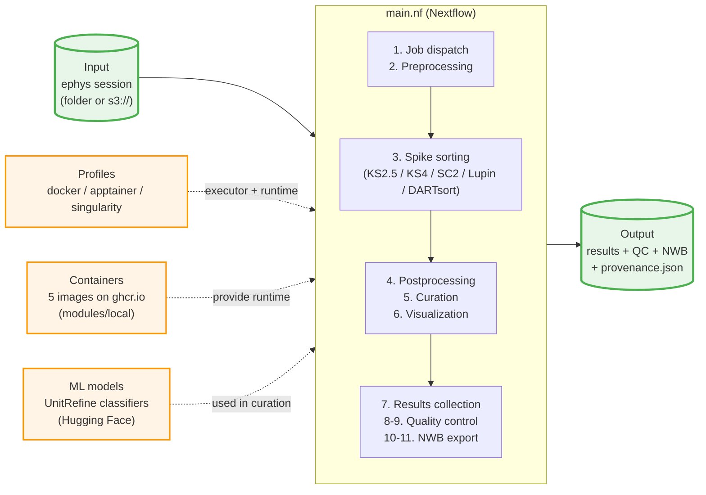

# AllenNeuralDynamics/aind-ephys-pipeline

## Introduction

**aind-ephys-pipeline** is an electrophysiology analysis pipeline built with
[SpikeInterface](https://github.com/SpikeInterface/spikeinterface) and [Nextflow](https://www.nextflow.io/).
It takes an extracellular electrophysiology session (AIND, SpikeGLX, Open Ephys, NWB or any
SpikeInterface-readable format), splits it into independent jobs per probe and shank, and runs
preprocessing, spike sorting (Kilosort2.5, Kilosort4, SpykingCircus2, Lupin or DARTsort), postprocessing,
curation, visualization, quality control and NWB export. Every step runs in a container with a pinned
copy of its code, so a pipeline version always produces the same processing. The pipeline runs with Docker,
Apptainer or Singularity.

## Pipeline summary

1. Job dispatch: split the session into one job per block, stream (probe), group (shank) and optionally segment ([`aind-ephys-job-dispatch`](https://github.com/AllenNeuralDynamics/aind-ephys-job-dispatch))
2. Preprocessing: phase shift, highpass/bandpass filter, bad channel removal, common median reference or destriping, motion estimation ([`aind-ephys-preprocessing`](https://github.com/AllenNeuralDynamics/aind-ephys-preprocessing))
3. Spike sorting with the selected sorter: [Kilosort2.5](https://github.com/AllenNeuralDynamics/aind-ephys-spikesort-kilosort25), [Kilosort4](https://github.com/AllenNeuralDynamics/aind-ephys-spikesort-kilosort4) (default), [SpykingCircus2](https://github.com/AllenNeuralDynamics/aind-ephys-spikesort-spykingcircus2), [Lupin](https://github.com/AllenNeuralDynamics/aind-ephys-spikesort-lupin) or [DARTsort](https://github.com/AllenNeuralDynamics/aind-ephys-spikesort-dartsort)
4. Postprocessing: duplicate unit removal, waveforms, templates, amplitudes, locations, PCs, correlograms, template and quality metrics ([`aind-ephys-postprocessing`](https://github.com/AllenNeuralDynamics/aind-ephys-postprocessing))
5. Curation: quality-metric thresholds, UnitRefine and Bombcell unit classification, SLAy merge suggestions ([`aind-ephys-curation`](https://github.com/AllenNeuralDynamics/aind-ephys-curation))
6. Visualization: timeseries snippets, drift maps, motion plots and interactive sorting summaries ([`aind-ephys-visualization`](https://github.com/AllenNeuralDynamics/aind-ephys-visualization))
7. Results collection: gather the per-job outputs into the final layout ([`aind-ephys-results-collector`](https://github.com/AllenNeuralDynamics/aind-ephys-results-collector))
8. Quality control per job ([`aind-ephys-processing-qc`](https://github.com/AllenNeuralDynamics/aind-ephys-processing-qc))
9. Quality control collection ([`aind-ephys-qc-collector`](https://github.com/AllenNeuralDynamics/aind-ephys-qc-collector))
10. NWB ecephys export: session metadata, raw and/or LFP data ([`aind-ecephys-nwb`](https://github.com/AllenNeuralDynamics/aind-ecephys-nwb))
11. NWB units export: add the sorted units to the NWB files ([`aind-units-nwb`](https://github.com/AllenNeuralDynamics/aind-units-nwb))

Steps 2 to 6 and 8 run in parallel, one task per job. A `provenance.json` with the pipeline version, the
repository and commit of every step and the parameters used is written next to the results.



## Usage

> [!NOTE]
> The pipeline needs [Nextflow](https://www.nextflow.io/docs/latest/install.html) 25.10 or newer and a
> container runtime (Docker, Apptainer or Singularity). The Kilosort2.5, Kilosort4 and DARTsort sorters need an
> NVIDIA GPU.

Run the pipeline on a session folder with Docker:

```bash
git clone https://github.com/AllenNeuralDynamics/aind-ephys-pipeline.git
cd aind-ephys-pipeline

nextflow run main.nf \
    -profile docker \
    --ecephys_path /path/to/session \
    --results_dir /path/to/results
```

or without cloning, from GitHub:

```bash
nextflow run AllenNeuralDynamics/aind-ephys-pipeline -r <version> \
    -profile docker \
    --ecephys_path /path/to/session \
    --results_dir /path/to/results
```

Choose the sorter with `--sorter` (`kilosort4` by default) and the input format with
`--job_dispatch.input` (`aind` by default; `spikeglx`, `openephys`, `nwb`, `spikeinterface`). Every parameter
and its default is in [`nextflow.config`](nextflow.config) and described in
[`nextflow_schema.json`](nextflow_schema.json); override them on the command line
(`--preprocessing.filter_type bandpass`) or with `-params-file my_params.json`.

For input layouts, profiles, parameters, compute resources and troubleshooting, see the
[usage documentation](docs/usage.md).

## Pipeline output

The results directory holds the collected preprocessing, spike sorting, postprocessing and curation outputs,
the visualizations, the quality control report, the NWB files and `provenance.json`.
See the [output documentation](docs/output.md) for details, and [CHANGELOG.md](CHANGELOG.md) for the release
history.

## Credits

aind-ephys-pipeline is developed and maintained by the
[Allen Institute for Neural Dynamics](https://alleninstitute.org/division/neural-dynamics/) (AIND).

The code of each step is developed in its own repository under
[AllenNeuralDynamics](https://github.com/AllenNeuralDynamics); a copy at a pinned commit is the step's script in
[`bin/`](bin). The UnitRefine classifiers used in curation are hosted by
[SpikeInterface on Hugging Face](https://huggingface.co/SpikeInterface).

## Contributions and support

If you would like to contribute to this pipeline, or if you find a bug or need help, please open an issue
on [GitHub](https://github.com/AllenNeuralDynamics/aind-ephys-pipeline/issues).

## Citations

If you use aind-ephys-pipeline for your analysis, please cite the tools it is built on:

- [SpikeInterface](https://github.com/SpikeInterface/spikeinterface)

  > Buccino AP, Hurwitz CL, Garcia S, Magland J, Siegle JH, Hurwitz R, Hennig MH. SpikeInterface, a unified
  > framework for spike sorting. eLife. 2020;9:e61834. doi: [10.7554/eLife.61834](https://doi.org/10.7554/eLife.61834)

- [Nextflow](https://www.nextflow.io/)

  > Di Tommaso P, Chatzou M, Floden EW, Barja PP, Palumbo E, Notredame C. Nextflow enables reproducible
  > computational workflows. Nat Biotechnol. 2017;35(4):316-319. doi: [10.1038/nbt.3820](https://doi.org/10.1038/nbt.3820)

- [nf-core](https://nf-co.re/) (pipeline layout and conventions)

  > Ewels PA, Peltzer A, Fillinger S, Patel H, Alneberg J, Wilm A, Garcia MU, Di Tommaso P, Nahnsen S. The
  > nf-core framework for community-curated bioinformatics pipelines. Nat Biotechnol. 2020;38(3):276-278.
  > doi: [10.1038/s41587-020-0439-x](https://doi.org/10.1038/s41587-020-0439-x)

- Spike sorters: cite the sorter you run
  - Kilosort2.5 and Kilosort4: [Kilosort](https://github.com/MouseLand/Kilosort)
    > Pachitariu M, Sridhar S, Pennington J, Stringer C. Spike sorting with Kilosort4. Nat Methods.
    > 2024;21:914-921. doi: [10.1038/s41592-024-02232-7](https://doi.org/10.1038/s41592-024-02232-7)
  - SpykingCircus2 and Lupin: implemented in [SpikeInterface](https://github.com/SpikeInterface/spikeinterface)
  - DARTsort: [DARTsort](https://github.com/cwindolf/dartsort)

- Curation tools
  - [UnitRefine](https://www.biorxiv.org/content/10.1101/2025.03.30.645770v1.full)
  - [Bombcell](https://zenodo.org/records/8172822)
  - [SLAy](https://www.biorxiv.org/content/10.1101/2025.06.20.660590v2)

- [NWB](https://www.nwb.org/) (Neurodata Without Borders) for the exported files
